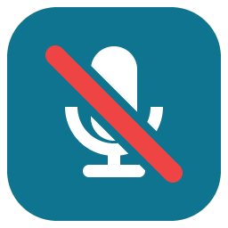

# Voice Moderation for Sharkord

**English** · [Português](#português)

Sharkord lets moderators kick someone from the server or drag them to another
voice channel, but not simply take them out of a call or mute them. This plugin
adds that, where you would look for it: **right-click a person in a voice
channel**, and under the host's own volume slider you get:

- **🔇 Mute (server)** / **🔈 Unmute (server)**: the person cannot unmute
  themselves until a moderator lifts it. Their audio is stopped on the server.
- **📵 Disconnect from call**: they leave the voice channel and stay on the
  server.

When a moderator lifts the mute, the person's mic comes back on by itself if it
was on before the mute (Sharkord leaves them muted otherwise).

The same actions are also on the user card of the call screen (right-click), as
icons in the avatar popover, and as slash commands:

| English | Português | |
| --- | --- | --- |
| `/disconnect <user>` | `/desconectar <usuario>` | take them out of the call |
| `/mute <user>` | `/mutar <usuario>` | server mute |
| `/unmute <user>` | `/desmutar <usuario>` | lift the server mute |

A unique prefix of the name is enough. Replies are private (only you see them).
The interface follows the language picked in Sharkord: Portuguese for `pt-BR`,
English for everything else.

## Permissions

Everything requires **Move members** (`MOVE_MEMBERS`), the permission Sharkord
already uses for dragging people between voice channels. The server checks it on
every action and command; users without it never see the menu items.

The menu items are plugin UI components. After enabling the plugin, open its
**Permissions** tab and turn on the three components (voice user row, voice user
card, user popover) for the roles that should moderate voice.

Nobody can disconnect or server-mute themselves with it.

## ⚠️ About the right-click

**The right-click menu is not an official plugin API.** Sharkord has no slot
for context-menu items, so the plugin finds the voice row and the host's volume
menu by their markup and places its items under the volume slider. Likewise,
switching the mic back on presses the host's own mic button, because the SDK
has no action for that.

That works on Sharkord **v0.0.31**, but a Sharkord update that changes this
markup can make the right-click items or the mic restore stop working. Nothing
breaks when that happens: the volume menu stays as it is, and the **slash
commands and popover icons**, which only use official SDK APIs, keep working.
All of these assumptions live in [`src/client/dom.ts`](src/client/dom.ts).

## Install

From the marketplace in **Server settings → Plugins**, or by hand: download
`voice-mod-<version>.tar.gz` from the
[releases](https://github.com/carlosj188/sharkord-voice-mod/releases), extract
it into the server's `plugins` folder (`~/.config/sharkord/plugins`, or
`data/plugins` in the Docker image) and enable it.

After an update, users have to **reload the app** (close the desktop app from
the tray and open it again) to get the new client.

## Development

Built from the official
[plugin-example](https://github.com/Sharkord/plugin-example) scaffold.

```bash
bun run setup   # clones the SDK and builder into .repos/ (not on npm yet)
bun run build   # dist/voice-mod/, copied to SHARKORD_PLUGINS_PATH if set
bun run publish # GitHub release + PR to the plugin registry (GITHUB_TOKEN)
```

```
src/server/index.ts   actions and slash commands (ctx.voice.disconnect / setServerMute)
src/client/           components for the voice_user_row, voice_user_card and user_popover slots
src/client/dom.ts     every assumption about Sharkord's markup
src/i18n.ts           all user-facing strings, English and Portuguese
src/types.ts          the contract shared by both halves
```

`bun x tsc --noEmit` reports errors from the linked Sharkord repo; only the ones
under `src/` are this plugin's.

---

## Português

O Sharkord deixa moderadores expulsarem alguém do servidor ou arrastarem para
outro canal de voz, mas não só tirar a pessoa da call ou mutá-la. Este plugin
faz isso, onde a gente procuraria: **clique com o botão direito na pessoa no
canal de voz** e, embaixo do controle de volume do próprio Sharkord, aparecem:

- **🔇 Mutar (servidor)** / **🔈 Desmutar (servidor)**: a pessoa não consegue se
  desmutar até um moderador tirar o mute. O áudio dela é cortado no servidor.
- **📵 Desconectar da call**: ela sai do canal de voz e continua no servidor.

Quando o moderador desmuta, o microfone da pessoa volta sozinho, se estava ligado
antes do mute (sem isso, o Sharkord a deixa mutada).

As mesmas ações também ficam no cartão da pessoa na tela da call (clique-direito),
como ícones no popover do avatar e como comandos de barra (tabela acima). Basta
o começo do nome, se não houver outro igual. As respostas são privadas. A
interface segue o idioma escolhido no Sharkord: português para `pt-BR`, inglês
para os demais.

### Permissões

Tudo exige **Mover membros** (`MOVE_MEMBERS`), a mesma permissão que o Sharkord
usa para arrastar pessoas entre canais de voz. O servidor confere em toda ação e
comando; quem não tem nem vê os itens.

Os itens do menu são componentes de interface do plugin. Depois de ativar o
plugin, abra a aba **Permissões** dele e ligue os três componentes (linha do
usuário na voz, cartão do usuário na voz, popover do usuário) para os cargos que
vão moderar a voz.

Ninguém consegue desconectar ou mutar a si mesmo por ele.

### ⚠️ Sobre o clique-direito

**O menu do clique-direito não é uma API oficial de plugins.** O Sharkord não
tem um slot para itens de menu de contexto, então o plugin encontra a linha da
pessoa e o menu de volume pela estrutura da página e coloca os itens embaixo do
volume. Do mesmo jeito, religar o microfone aperta o próprio botão de microfone
do app, porque o SDK não tem uma ação para isso.

Funciona no Sharkord **v0.0.31**, mas uma atualização que mude essa estrutura
pode fazer os itens do clique-direito ou a volta do microfone pararem de
funcionar. Nada quebra se isso acontecer: o menu de volume continua igual, e os
**comandos de barra e os ícones do popover**, que só usam APIs oficiais do SDK,
continuam funcionando. Todas essas suposições ficam em
[`src/client/dom.ts`](src/client/dom.ts).

### Instalação

Pelo marketplace em **Configurações do servidor → Plugins**, ou à mão: baixe o
`voice-mod-<versão>.tar.gz` nas
[releases](https://github.com/carlosj188/sharkord-voice-mod/releases), extraia
na pasta `plugins` do servidor (`~/.config/sharkord/plugins`, ou `data/plugins`
na imagem Docker) e ative.

Depois de uma atualização, cada pessoa precisa **recarregar o app** (fechar o app
desktop pela bandeja e abrir de novo) para pegar o cliente novo.

## License

[MIT](LICENSE)
